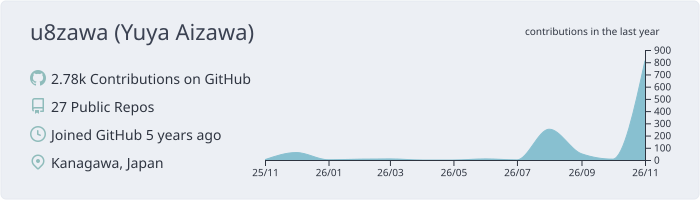
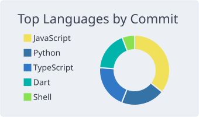
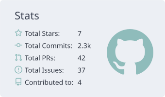
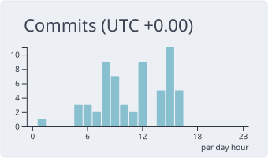

# こんにちは、u8zawa です👋

ポートフォリオ: https://u8zawa.pages.dev

## Skills

- **言語**: TypeScript / JavaScript / Python / Java / Swift / Dart
- **Web・アプリ**: React / Astro / Vite / Node.js / Flutter
- **ブラウザ ML・画像処理**: TensorFlow.js / ONNX Runtime Web / OpenCV.js
- **クラウド・インフラ**: Azure / AWS / Cloudflare / Terraform / Docker / GitHub Actions

## Works

- [tuginani 時間割](https://play.google.com/store/apps/details?id=com.zawa.flutter_school_timetable) — 学生向けの時間割アプリ（Flutter / Firebase）
- [kamiscan](https://u8zawa.pages.dev/works/kamiscan) — ブラウザで書類を撮影し、台形補正して端末に保存するスキャナ（画像は端末から出ない）
- [bull-sound](https://github.com/u8zawa/bull-sound) — ダーツのブル命中を判定して効果音を鳴らす Web アプリ（[デモ](https://u8zawa.github.io/bull-sound/)）

## GitHub Stats

 

 

## Contact

- X: [@zawa__713__](https://x.com/zawa__713__)
